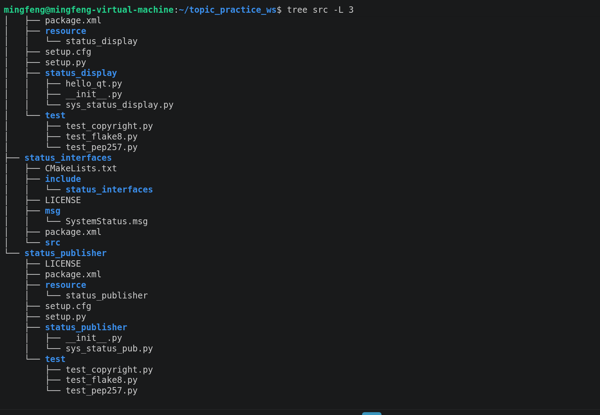
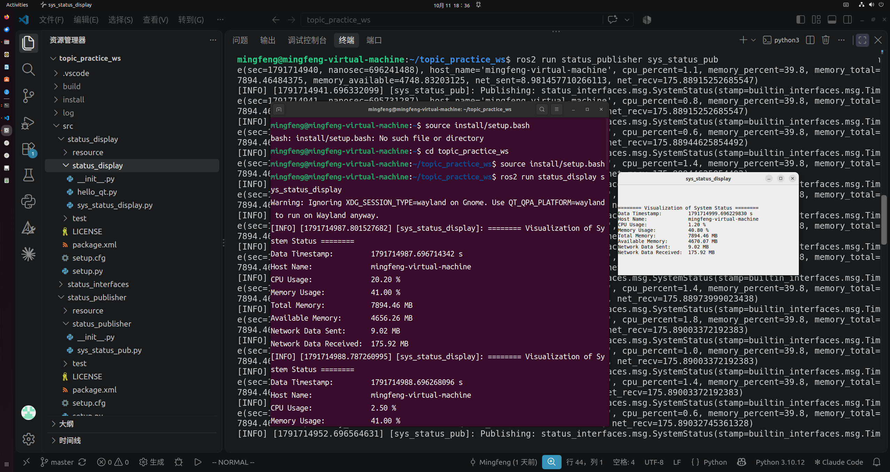
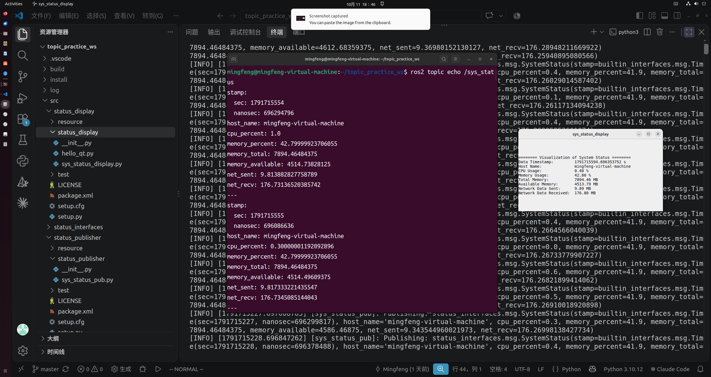
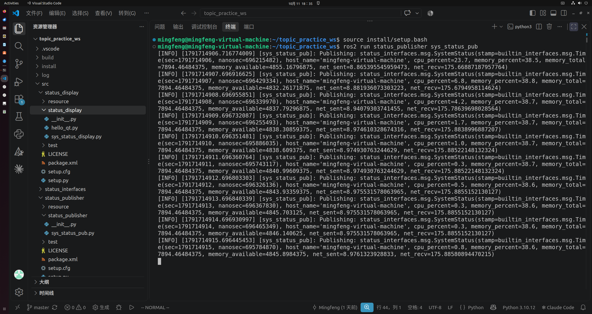

# SysStatus Monitor —— ROS 2 系统状态监控工具

&gt; 武汉理工大学 WUTA 无人驾驶方程式赛车队 2026 无人组招新笔试题

## 功能一览
- 周期性采集系统状态：时间戳、主机名、CPU/内存使用率、内存总量/剩余、网络收发量
- 通过 ROS 2 话题 `/sys_status` 发布（发布节点：Python）
- PyQt5 小窗口实时显示订阅数据（显示节点：Python）
- 自定义消息接口 `SystemStatus.msg`（8 字段，独立接口包）

## 系统架构
（贴架构图：/sys_status_pub → /sys_status → /sys_status_display）



## 环境要求
- Ubuntu 22.04 + ROS 2 Humble
- Python 3.10，依赖：`psutil`、`PyQt5`（`sudo apt install python3-pyqt5`）

## 快速开始
​```bash
git clone https://github.com/MingfengChen-mf/topic_practice_ws.git
cd topic_practice_ws
colcon build
source install/setup.bash

# 终端1：发布
ros2 run status_publisher sys_status_pub
# 终端2：显示（新开终端需重新 source）
ros2 run status_display sys_status_display
​```

## 运行效果
（截图：Qt 窗口一张 + ros2 topic echo 一张 +pub 包终端运行一张）







## 项目结构

```
src/
├── status_interfaces/        # ament_cmake：自定义消息接口
│   ├── msg/SystemStatus.msg  # 8 字段状态消息定义
│   ├── CMakeLists.txt        # rosidl 接口注册
│   └── package.xml
├── status_publisher/         # ament_python：采集 + 发布
│   ├── status_publisher/sys_status_pub.py
│   └── setup.py              # entry point: sys_status_pub
└── status_display/           # ament_python：订阅 + PyQt5 显示
    ├── status_display/sys_status_display.py
    └── setup.py              # entry point: sys_status_display
```

## 实现说明
- 显示节点采用 Python + PyQt5 实现（参考教材为 C++ 版），
  使用 QTimer 定时调用 rclpy.spin_once() 融合 Qt 与 ROS 双事件循环，
  避免多线程操作 GUI 的线程安全问题。
- Claude协作纠错记录见 纠错日志.md。
- ROS2总学习时长已超10h

## License
Apache-2.0